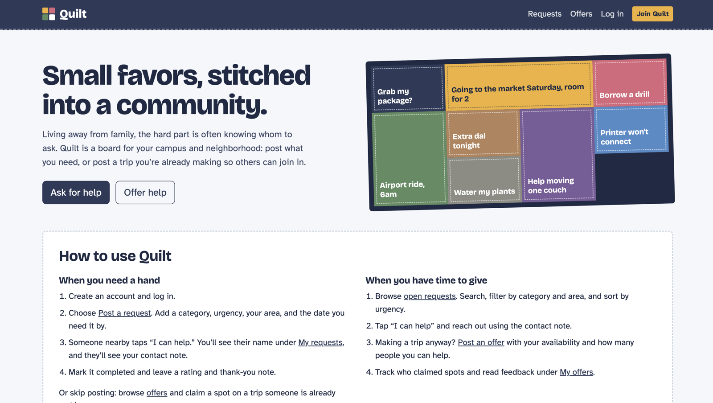
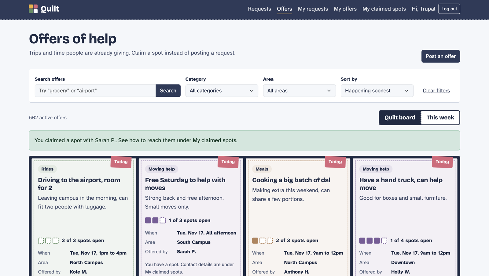
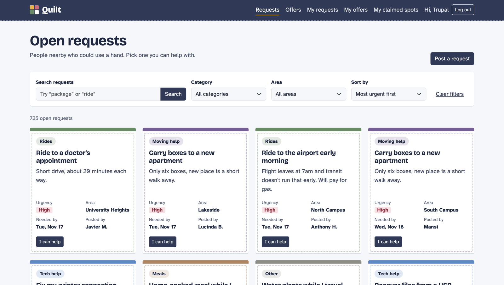
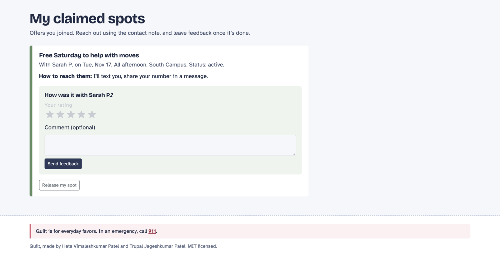
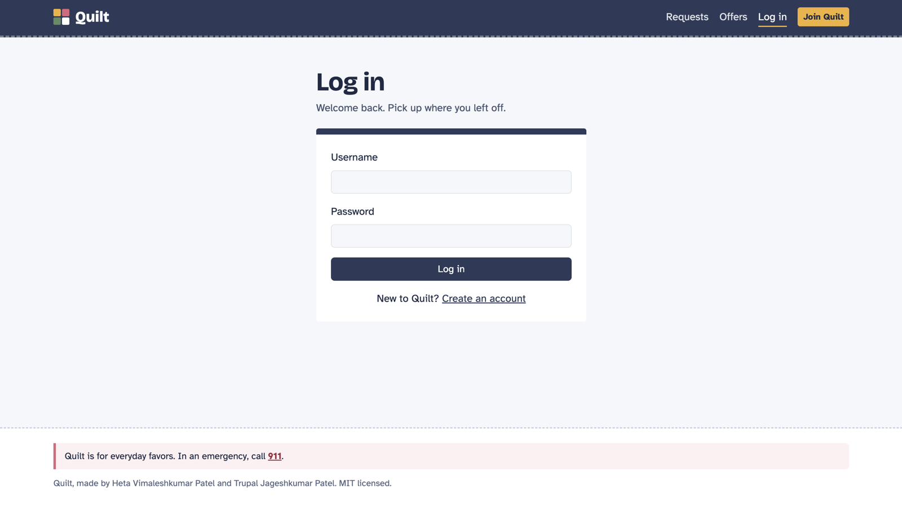
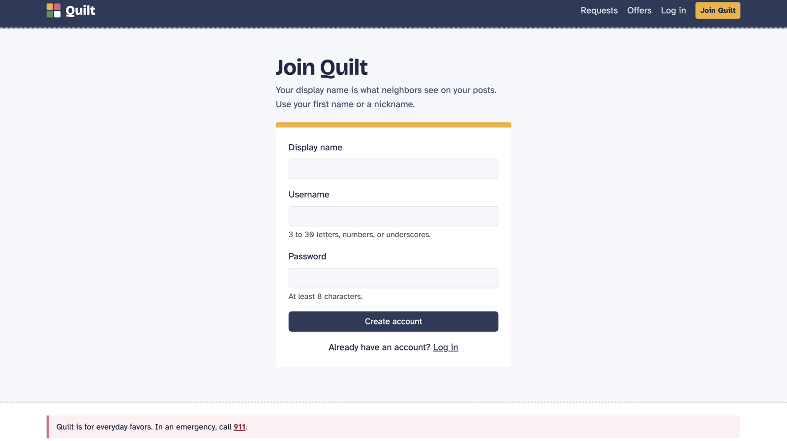

# Quilt

Community support and help exchange for students living away from family.

**Authors:** Heta Vimaleshkumar Patel and Trupal Jageshkumar Patel

**Class:** [CS 5610 Web Development, Northeastern University](https://johnguerra.co/classes/webDevelopment_online_fall_2026/)

**Live app:** https://quiltapp.onrender.com

**Demo video:** https://youtu.be/PMfS5-C8Qus

**Presentation video:** https://youtu.be/B0uSDcJKuvI

**Slides:** https://docs.google.com/presentation/d/13tQG-h5nn3-b5C339QzsjwyMYvQN2s5Z/edit?usp=sharing

**Design document:** [design-document.pdf](design-document.pdf) (Markdown version: [docs/design-document.md](docs/design-document.md))

## Project objective

Students living away from family often need small favors but don't know whom
to ask: groceries, a package pickup, a borrowed essential item. Quilt is a
campus and neighborhood board where people post **requests** when they need
help, or **offers** when they have time to give. Like a quilt, many small
pieces of help make a supportive community.

Quilt is for everyday favors, not emergencies. In an emergency, call 911.



## Screenshots

| Home                               | Offers: quilt board                                 |
| ---------------------------------- | --------------------------------------------------- |
|  |  |

| Open requests                              | My claimed spots                                   |
| ------------------------------------------ | -------------------------------------------------- |
|  |  |

| Log in                           | Join Quilt                              |
| -------------------------------- | --------------------------------------- |
|  |  |

## Features

**Help requests** (Heta, `helpRequests` collection)

- Post a request with a category, urgency, area, needed-by date, and a private
  contact note; edit or delete it.
- Browse open requests: search, filter by category and area, sort by urgency,
  and tap "I can help."
- Move a request between open, in progress, and completed; view completed
  requests; leave a star rating and thank-you note for the helper.

**Help offers** (Trupal, `helpOffers` collection)

- Post an offer with a date, availability, area, and number of spots; edit or
  delete it.
- Browse active offers: search, filter by category and area, claim a spot, and
  leave feedback afterward.
- See who claimed your offer, mark it full or completed, view past offers, and
  read the feedback you received.

**Shared**

- Accounts with Passport (local strategy) and sessions stored in MongoDB.
- Contact notes are visible only to the people involved; posts show a general
  area, never an address.

## How to use Quilt

1. Create an account, or log in with a demo account (see below).
2. **Need help?** Choose _Post a request_. When someone taps "I can help," you
   see their name under _My requests_. Mark the request completed and thank
   them with a rating.
3. **Have time?** Browse _Requests_ and tap "I can help." The requester's
   contact note appears under _My requests_ in the _Helping_ tab.
4. **Making a trip anyway?** Choose _Post an offer_. Track claims and feedback
   under _My offers_.
5. **Want to join a trip?** Browse _Offers_ and claim a spot. Find the contact
   note and leave feedback under _My claimed spots_.

Demo accounts created by the seed script (password `password123`):
`mansi`, `janvi`, `shivani`.

## Tech stack

- Node.js + Express (backend, `server.js`)
- MongoDB with the official Node driver (no Mongoose)
- React 18 with hooks, client-side rendered, built with Vite
- Passport (local strategy), express-session, connect-mongo
- react-router-dom, prop-types, Bootstrap
- ESLint and Prettier

The frontend calls the API with `fetch`. In development, Vite proxies `/api`
to Express; in production, Express serves the built React app. The browser
always talks to one origin, so no CORS library is needed.

## Instructions to build and run

Requirements: Node.js 20 or later and a MongoDB database (local or Atlas).

```bash
# 1. Install backend dependencies
npm install

# 2. Configure environment variables
cp .env.example .env
# then edit .env with your MONGO_URI and a long random SESSION_SECRET

# 3. Seed the database (40 users, 1,200 requests, 1,200 offers)
npm run seed

# 4. Install and build the frontend
npm run build

# 5. Start the server
npm start
# open http://localhost:3000
```

For development with hot reload, run these in two terminals:

```bash
npm run dev                 # Express API on port 3000
npm run dev --prefix frontend   # React app on port 5173
```

Quality checks:

```bash
npm run lint      # ESLint for backend and frontend
npm run format    # Prettier for all files
```

## Deployment (Render)

1. Push the repository to GitHub (`.env` is git-ignored).
2. Create a Render **Web Service** from the repository.
3. Build command: `npm install && npm run build`. Start command: `npm start`.
4. Add environment variables `MONGO_URI`, `DB_NAME`, `SESSION_SECRET`, and
   `NODE_ENV=production`.
5. In MongoDB Atlas, allow connections from Render's IP addresses.

## Project structure

```
server.js              Express app, sessions, Passport, static frontend
auth/                  Password hashing and Passport strategy
db/                    MongoDB connection and one module per collection
routes/                auth, requests (Heta), offers (Trupal)
seed/                  Synthetic data generators
design-document.pdf    Design document (PDF)
docs/                  Design document (Markdown), mockups, screenshots, thumbnail
frontend/src/
  components/layout    Layout (Trupal), NavBar (Heta), EmergencyNotice
  components/shared    PatchCard, Pagination, StarRating, ProtectedRoute
  components/requests  Request components (Heta)
  components/offers    Offer components (Trupal)
  pages/               Home, Login, Register (Trupal), NotFound
```

Each React component lives in its own file with a matching CSS file.

## Use of AI

We used Claude (Anthropic) to brainstorm and refine the project idea, to
generate a first version of the code, to draft the design document, and to
create the wireframe mockups and the thumbnail. We reviewed, ran, and tested
the app ourselves, fixed the bugs we found, merged our work through pull
requests, and each of us can explain our own part of the code.

## License

[MIT](LICENSE)
