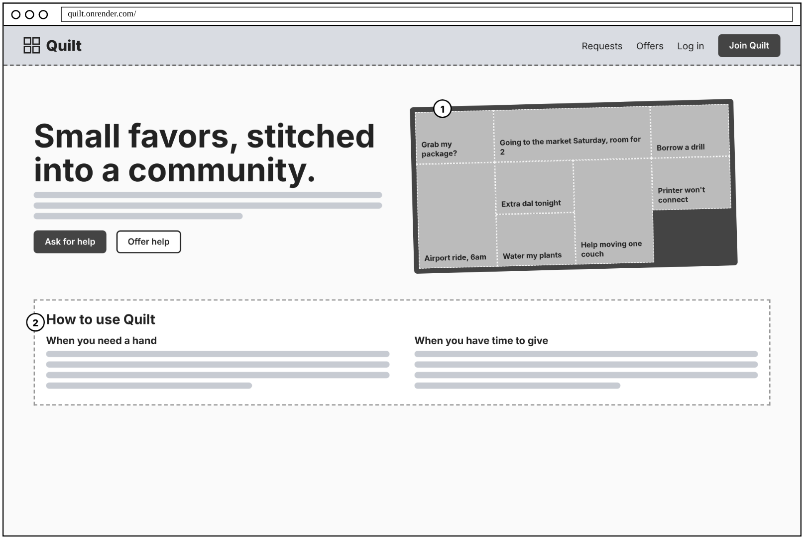
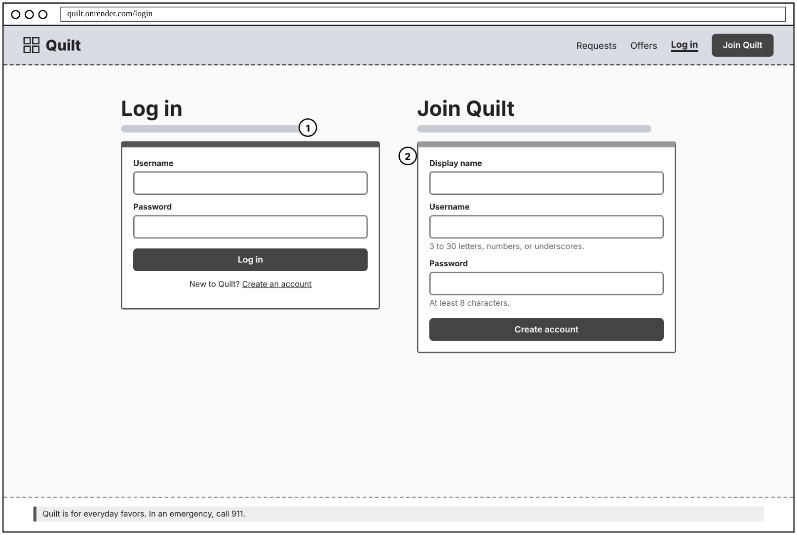
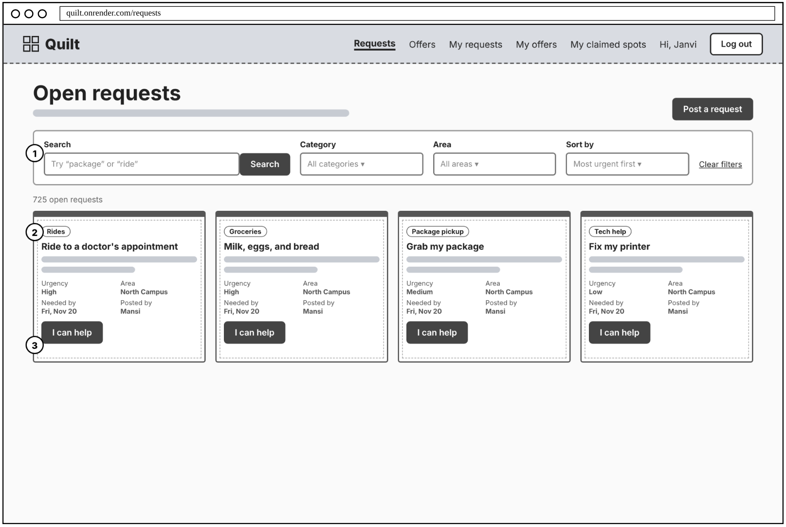
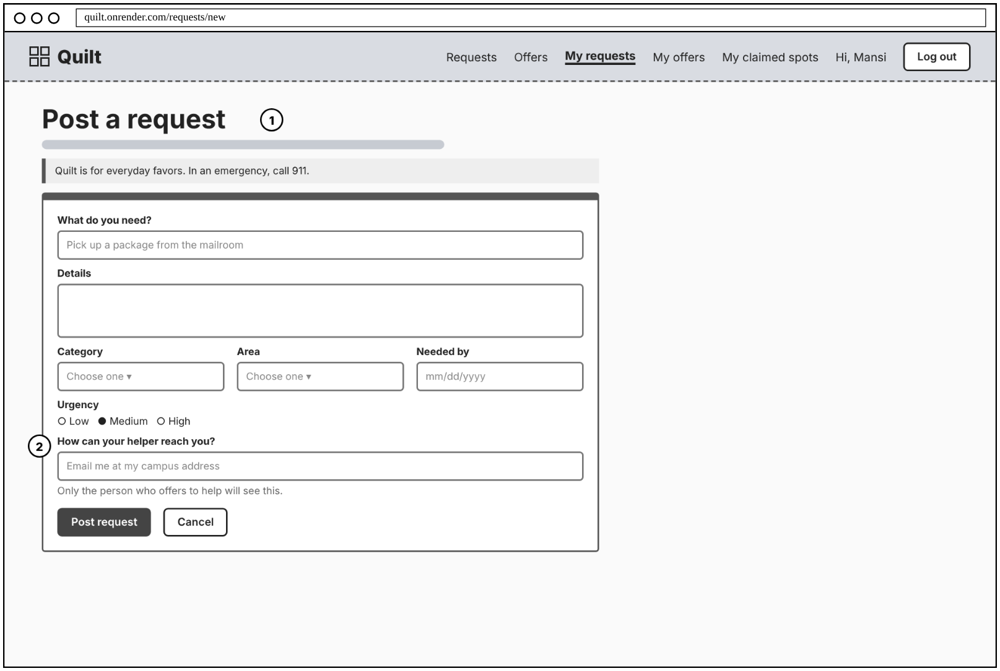
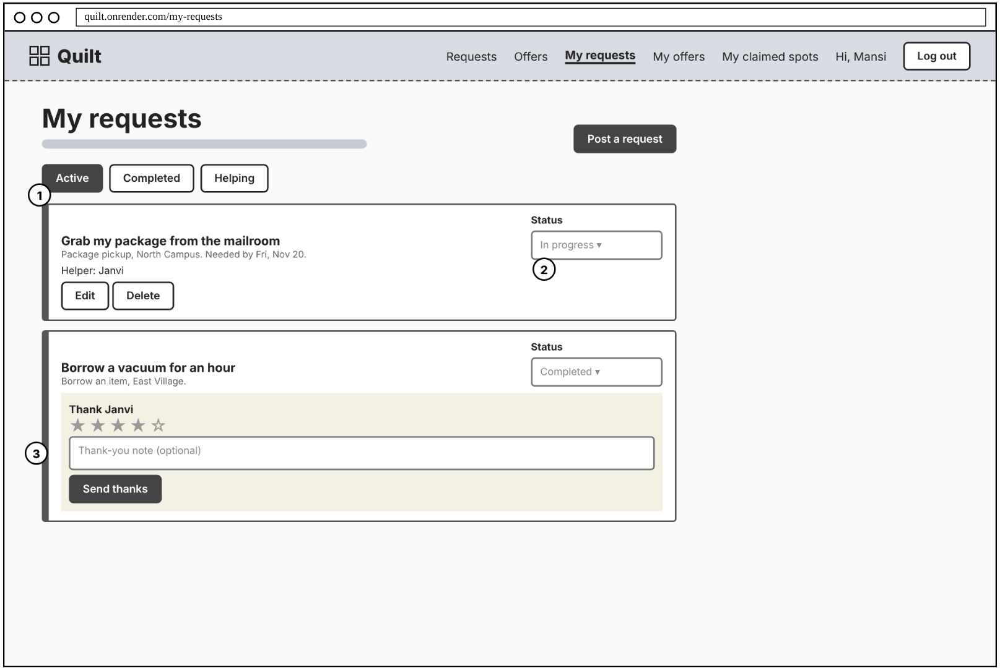
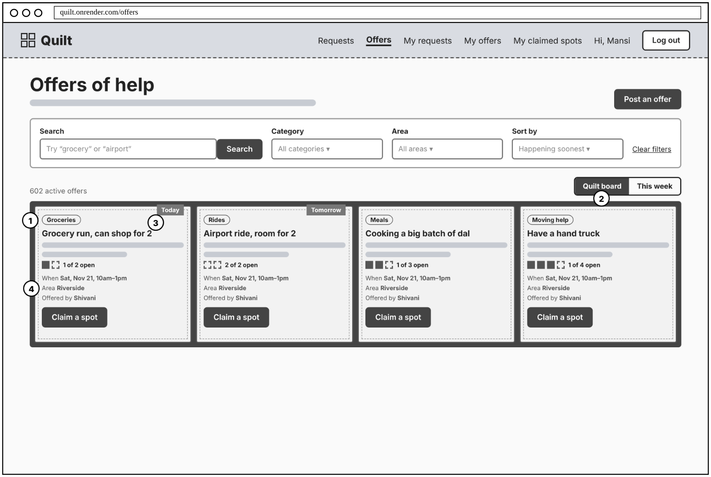
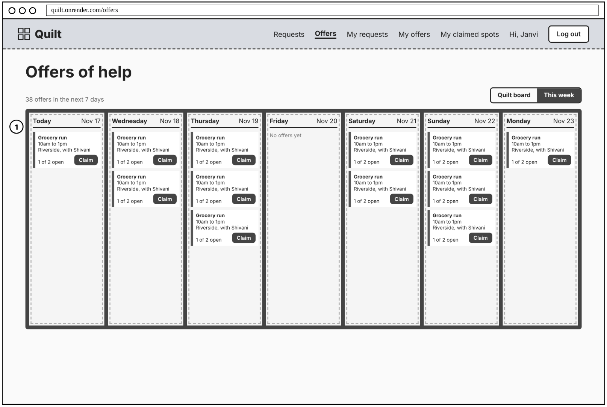
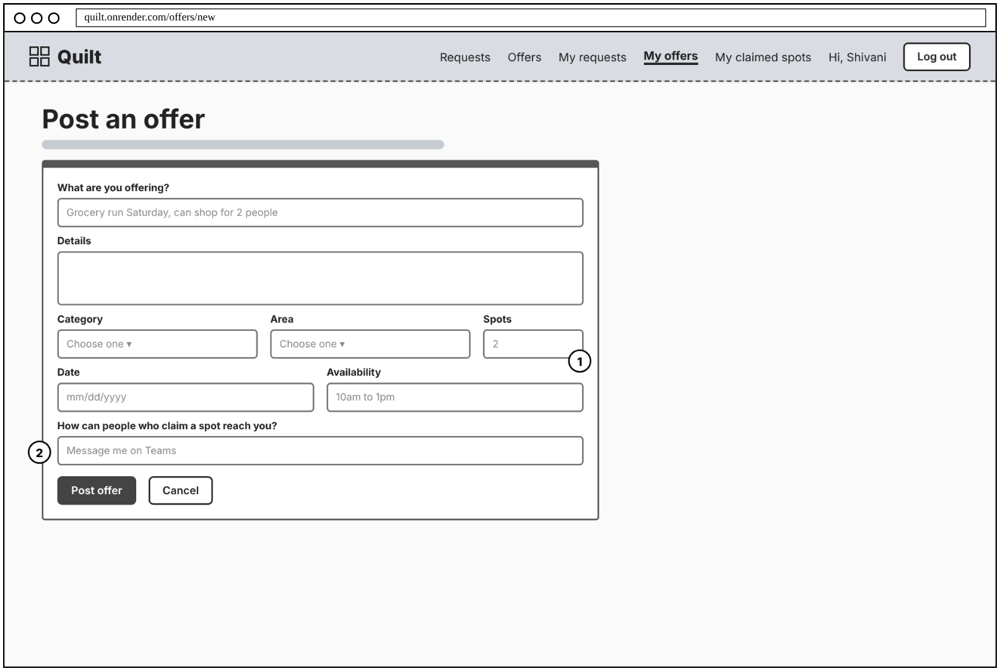
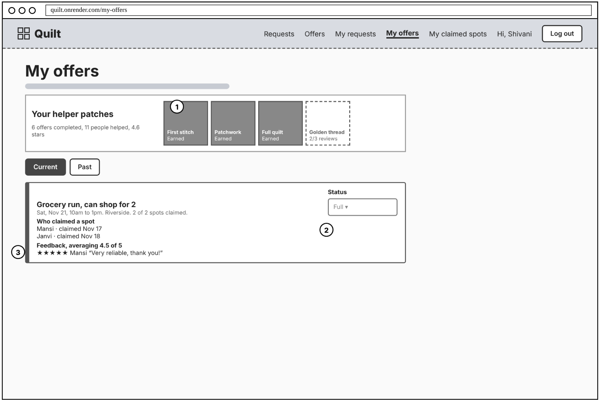
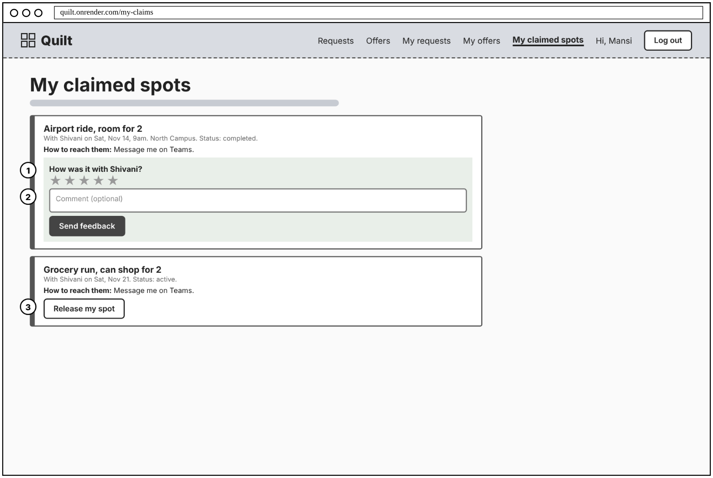

# Quilt: Design Document

**Project 3, CS 5610 Web Development**
**Team:** Heta Vimaleshkumar Patel and Trupal Jageshkumar Patel

## 1. Project description

Students living away from family often need small favors but don't know whom to ask: groceries, a package pickup, a borrowed essential item. Quilt is a campus and neighborhood board where people post **requests** when they need help, or **offers** when they have time to give. Like a quilt, many small pieces of help make a supportive community.

Quilt is for everyday favors, not emergencies. Every page reminds users to call 911 in an emergency.

**Goals**

- Make asking for small help feel normal and low-pressure.
- Let people share trips they are already making, so one car ride helps several people.
- Close the loop with ratings and feedback, so helpers feel appreciated and trust grows.
- Protect privacy: posts show only a general area, and contact details are shared only with the people involved.

**Stack:** Node + Express, MongoDB (Node driver, no Mongoose), React with hooks (client-side rendering, built with Vite), Passport local authentication.

## 2. User personas

### Mansi, international student living alone

- **Background:** First-year graduate student who moved from India a few months ago. Lives alone in a studio near campus, has no car, and is still learning the city.
- **Goals:** Get small things done when she is sick or busy without feeling like a burden. Build connections with people nearby.
- **Frustrations:** Requests in group chats get buried. She doesn't know which classmates live close by or have a car.
- **How Quilt helps:** She posts a request with an urgency level, or claims a spot on someone's grocery trip without posting anything.

### Janvi, student with free time

- **Background:** Second-year undergraduate with a light semester and a part-time campus job. Remembers how hard her own first year was.
- **Goals:** Help people nearby in small, concrete ways that fit her schedule.
- **Frustrations:** Wants to help but rarely hears about specific needs until it is too late.
- **How Quilt helps:** She filters open requests by her area, sorts by urgency, and taps "I can help."

### Shivani, student with a car

- **Background:** Graduate student who drives to the grocery store and the airport regularly.
- **Goals:** Share trips she is already making so others don't pay for rides or carry heavy bags on transit.
- **Frustrations:** Coordinating over text is messy, and she loses track of who asked to come along.
- **How Quilt helps:** She posts an offer with a number of spots, sees who claimed them, and earns helper patches as she completes offers.

## 3. User stories

### Heta Vimaleshkumar Patel: help requests (`helpRequests` collection)

1. **Post and manage a request.** As Mansi, an international student living alone, I want to post a help request with a category, urgency, area, and needed-by date, and edit or delete it, so that people nearby know what I need.
2. **Find someone to help.** As Janvi, a student with free time, I want to browse and search open requests, filter by category and area, sort by urgency, and say I can help, so that I can support someone near me.
3. **Close the loop.** As Mansi, I want to update my request's status (open, in progress, completed), view my completed requests, and leave a rating and thank-you note for the helper, so that I can close the loop.

### Trupal Jageshkumar Patel: help offers (`helpOffers` collection)

4. **Post and manage an offer.** As Shivani, a student with a car, I want to post an offer of help (for example, "going grocery shopping Saturday, can shop for 2 people") with availability, area, and spots, and edit or delete it, so that others benefit from trips I'm already making.
5. **Join an offer.** As Mansi, I want to browse and search active offers, filter by category and area, claim a spot, and leave feedback afterward, so that I can get help without posting a request.
6. **Manage my commitments.** As Shivani, I want to see who claimed my offer, mark it full or completed, view my past offers, and read feedback I received, so that I can manage my commitments.

### Shared

- **Accounts.** As any student, I want to create an account and log in, so that my posts, claims, and ratings are tied to me. (Passport local strategy, shared `users` collection.)

## 4. Design mockups

Low-fidelity wireframes of each main screen, shown in a browser frame. Numbered markers on each wireframe match the notes listed below it.

### 4.1 Home page (Trupal)

The hero shows a tilted quilt of example favors, the app's signature visual. Below it, "How to use Quilt" gives step-by-step instructions for people who need help and people who want to help.

1. Hero quilt: favors as sewn patches, the app's signature visual
2. Step-by-step instructions for both kinds of users

### 4.2 Log in and Join Quilt (Trupal, with Heta's Passport backend)

Simple forms with clear rules for usernames and passwords. The 911 reminder appears in the footer of every page.

1. Passport local login; session stored in MongoDB
2. Display name is what neighbors see on posts

### 4.3 Browse open requests (Heta, story 2)

Search, category and area filters, and a sort by urgency. Each card is colored by category and shows urgency, area, needed-by date, and who posted it.

1. Search, filter by category and area, sort by urgency
2. Card color = category; urgency badge
3. “I can help” assigns you as helper

### 4.4 Post or edit a request (Heta, story 1)

The same form is used to create and edit. The contact note is shown only to the person who offers to help.

1. Same form is reused for editing
2. Contact note stays private; no street addresses

### 4.5 My requests (Heta, stories 1 and 3)

Tabs for active, completed, and requests the user is helping with. The status dropdown moves a request from open to in progress to completed, and a rating form appears once it is completed.

1. Tabs: active, completed, and requests I'm helping with
2. Status dropdown: open → in progress → completed
3. Rating + thank-you note once completed

### 4.6 Offers: quilt board view (Trupal, story 5)

Offers are laid out like patches sewn onto a dark backing. Spot squares fill in as people claim them, and "Today" or "Tomorrow" tags mark offers happening soon.

1. Quilt board: offers sewn together on a dark backing
2. Switch between board and week calendar
3. “Today/Tomorrow” fabric tags for offers happening soon
4. Spot squares fill in as people claim

### 4.7 Offers: this week view (Trupal, story 5)

A seven-day calendar starting today, so users can plan around trips. Spots can be claimed straight from the calendar.

1. Seven columns starting today; claim directly from the calendar

### 4.8 Post or edit an offer (Trupal, story 4)

The offerer sets the date, availability, area, and number of spots (1 to 10). The contact note is shown only to people who claim a spot.

1. Spots limit how many people can claim (1–10)
2. Contact note only shown to people who claim

### 4.9 My offers (Trupal, story 6)

Helper patches reward completed offers and good ratings. Each offer lists who claimed a spot, has a status dropdown (active, full, completed), and shows feedback received.

1. Badges earned from completed offers and ratings
2. Mark offers active, full, or completed
3. See claimers and read feedback received

### 4.10 My claimed spots (Trupal, story 5)

After claiming, the user sees the offerer's contact note. They can release a spot if plans change, and leave feedback once the offer is done.

1. Contact note revealed only after claiming
2. Feedback form appears once the offer is done
3. Release a spot if plans change

## 5. Visual design

The interface is built around the quilt metaphor: every post is a fabric patch, and the community is the quilt they form together.

| Element      | Choice                                              | Why                                                                         |
| ------------ | --------------------------------------------------- | --------------------------------------------------------------------------- |
| Base colors  | Denim `#2E3A59`, ink `#1F2A44`, linen `#F5F7FA`     | Calm, trustworthy, and readable                                             |
| Patch colors | Marigold, rose, moss, clay, plum, sky, stone        | One fabric color per category, so categories are easy to scan               |
| Headings     | Bricolage Grotesque                                 | Warm and friendly, with personality                                         |
| Body text    | Atkinson Hyperlegible                               | Designed for readability, which helps students reading in a second language |
| Motifs       | Dashed "stitching" lines, patch cards, sewn-on tags | Ties every screen to the quilt idea                                         |

Accessibility: real buttons and form labels throughout, visible keyboard focus, a skip-to-content link, and reduced motion respected.

## 6. Data model

**`users`** (shared): `username`, `displayName`, `passwordHash`, `salt`, `createdAt`

**`helpRequests`** (Heta): `title`, `description`, `category`, `urgency`, `urgencyRank`, `area`, `neededBy`, `contactNote`, `status` (open, in progress, completed), `requester {_id, displayName}`, `helper {_id, displayName} | null`, `rating {stars, note, createdAt} | null`, `createdAt`, `updatedAt`

**`helpOffers`** (Trupal): `title`, `description`, `category`, `area`, `date`, `availability`, `spots`, `contactNote`, `status` (active, full, completed), `offerer {_id, displayName}`, `claims [{userId, displayName, claimedAt}]`, `feedback [{userId, displayName, stars, comment, createdAt}]`, `createdAt`, `updatedAt`

Each feature collection is seeded with 1,200 synthetic records.

## 7. API overview

| Method and route                                                                  | Purpose                                                | Owner  |
| --------------------------------------------------------------------------------- | ------------------------------------------------------ | ------ |
| `POST /api/auth/register`, `/login`, `/logout`; `GET /api/auth/me`                | Accounts and sessions                                  | Heta   |
| `GET /api/requests`                                                               | Browse, search, filter, and sort open requests         | Heta   |
| `GET /api/requests/mine`, `/helping`                                              | My requests; requests I'm helping with                 | Heta   |
| `POST`, `PUT`, `DELETE /api/requests/:id`                                         | Create, edit, delete a request                         | Heta   |
| `POST /api/requests/:id/help`; `PATCH /:id/status`; `POST /:id/rating`            | I can help; update status; rate helper                 | Heta   |
| `GET /api/offers`, `/week`                                                        | Browse offers as a board or a week calendar            | Trupal |
| `GET /api/offers/mine`, `/claimed`, `/stats`                                      | My offers; my claimed spots; helper patch totals       | Trupal |
| `POST`, `PUT`, `DELETE /api/offers/:id`                                           | Create, edit, delete an offer                          | Trupal |
| `POST`, `DELETE /api/offers/:id/claim`; `PATCH /:id/status`; `POST /:id/feedback` | Claim or release a spot; update status; leave feedback | Trupal |
